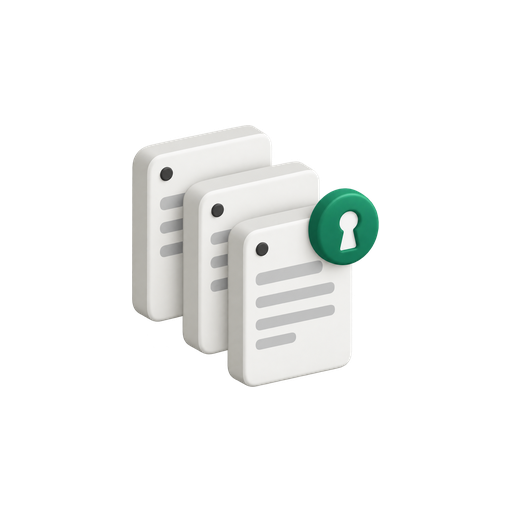
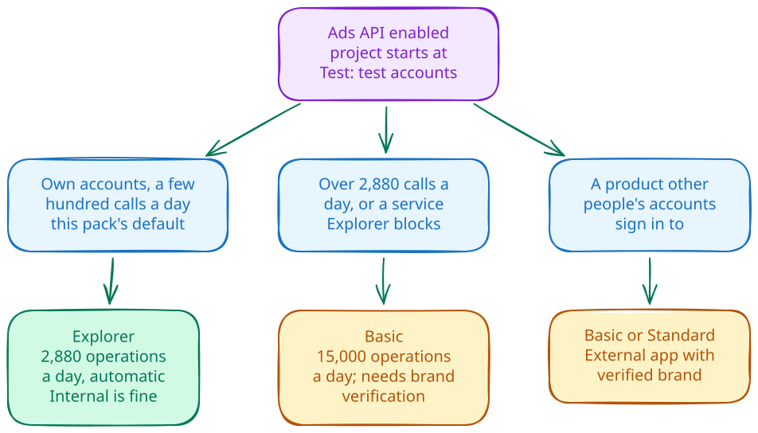

# Google Ads credentials



The pack reads Google Ads through one file, `google-ads.yaml`. This guide covers
what goes into that file, which Google Ads API access level your Cloud project
needs, and how to build the file from scratch. Do it once before the first
deployment, and again whenever you replace the OAuth client.

## How the pieces fit

Think of the Cloud project as a car. Its access level is the road permit, which
decides the roads the car may use (test accounts or real ones) and how far it
may drive each day. The consent screen decides who may drive. The refresh token
is one driver's signed permission, and it is valid only for the car it was
signed for.


[Editable credential scene](diagrams/credential-pieces.excalidraw)

| Piece | Where it lives | What it does |
|---|---|---|
| Access level | The pack's own Cloud project | Sets which Google Ads accounts the project may call and how many operations it may run per day. |
| OAuth client | The same project, as a Desktop app client | Identifies the pack when it trades the refresh token for short-lived access. |
| Refresh token | `google-ads.yaml`, then a Secret Manager version | The consent of the Google user who manages your Google Ads manager account (MCC), granted through that client for the `https://www.googleapis.com/auth/adwords` scope. |

Since 2026-09-09 Google grants the access level to the Cloud project that owns
the OAuth client, not to a developer token
([developer token notice](https://developers.google.com/google-ads/api/docs/api-policy/developer-token)).
The file still carries a `developer_token` key, because the pinned client
library (google-ads 31.4.0) rejects a configuration without one. Google ignores
the value. The file also names the manager account as `login_customer_id`.

From there the deployment ladder takes over. Phase 00 probes every allowlisted
account with the file. Phase 30 stores it as a new Secret Manager version.
Phase 50 pins the Cloud Run Job to that version number, and the job reads the
file from its mount.

Create the OAuth client in the pack's own project. Google's
[OAuth overview](https://developers.google.com/google-ads/api/docs/oauth/overview)
asks for the credentials in the project where the Google Ads API is enabled and
the access level is held. A client borrowed from another project brings that
project's access level with it. When that project is shut down, the client goes
with it, Google rejects the refresh token, and the nightly run fails.

## Choose an access level



[Editable access-level scene](diagrams/access-levels.excalidraw)

| Level | Accounts it can call | Operations per day | How to get it |
|---|---|---|---|
| Test | Test accounts only | 15,000 | Granted when you enable the Google Ads API. |
| Explorer | Test and production accounts | 2,880 on production accounts | Apply on the Google Ads API Overview page. Google reviews it automatically; no brand verification. Explorer blocks account creation, user management, the planning services, and billing. |
| Basic | Test and production accounts | 15,000 | Apply from Explorer. A new application needs brand verification of the project first. |
| Standard | Test and production accounts | Unlimited | Apply from Basic. A manual review takes about ten business days. |

Source: [access levels](https://developers.google.com/google-ads/api/docs/api-policy/access-levels).
Each search request counts as one operation however many rows it returns
([quotas](https://developers.google.com/google-ads/api/docs/best-practices/quotas)),
and the day is a sliding 24 hours. The pack sends 17 queries for each allowlisted
account per nightly run, plus the monthly chunks of an incremental history
backfill.

The consent screen comes in two kinds:

- **Internal.** Only users in the Google Cloud organization that owns the
  project can sign in; anyone else gets an `org_internal` error. There is no
  publishing status and no verification, and the seven-day testing expiry does
  not apply to its refresh tokens. Set `PMAX_OAUTH_PUBLISHING_STATUS=internal`.
- **External.** Any Google account can sign in. Keep its publishing status at
  In production, because a refresh token minted while the app is in Testing
  expires after seven days
  ([refresh-token expiration](https://developers.google.com/identity/protocols/oauth2#expiration)),
  and phase 30 refuses `Testing`. Set
  `PMAX_OAUTH_PUBLISHING_STATUS=production`.

Three cases cover most installs:

1. **You report on your own accounts.** A handful of people use the reports and
   the job makes a few hundred calls a day. Use Explorer with an Internal
   consent screen (External in production works too). This is the pack's
   default; with three accounts it sends 51 operations a night.
2. **You need more than 2,880 operations a day, or a service Explorer blocks.**
   Apply for Basic. Brand verification comes first, and it needs an External
   consent screen in production, a public home page, a privacy policy, terms of
   service, and an authorized domain verified in Google Search Console. The
   automated check takes minutes; a manual review takes two to three business
   days. Budget a day for the website and domain work.
3. **Other people's Google Ads accounts sign in to your product.** Use an
   External consent screen with a verified brand, and Basic or Standard. The
   pack is not built for this case.

To see where you stand, open the
[Google Ads API Overview page](https://console.cloud.google.com/google/ads-apis/overview)
for the project. It shows the access level. Requests per day are on the Google
Ads API's **Metrics** page under **APIs & Services**. Moving from case 1 to case
2 gains nothing until that count gets close to 2,880.

Projects that made API calls with an approved developer token in the 90 days
before 2026-09-09 inherited that token's level, without brand verification. So
an existing installation may show Basic on an Internal app. That is
grandfathered; a new project cannot get there that way. Google may revoke the level
of a project that makes no calls for 90 days; it then falls back to Test.

## Create the credential file

You need the deployment project from your config, billed and labelled as the
[README](../README.md#deploy-and-upgrade) describes. Managing the access level
needs Owner, Editor, Quota Administrator, or Service Usage Admin on the project.
Keep every file below outside any repository.

1. **Enable the Google Ads API.** Phase 00 probes the credential before phase 10
   runs, so on a first deployment enable it by hand. In the console, open
   **APIs & Services > Library**, search for **Google Ads API**, and click
   **Enable**. From a terminal:

   ```bash
   gcloud services enable googleads.googleapis.com --project=your-gcp-project-id
   ```

   Phase 10 enables it again on every ladder pass.

2. **Set up the Google Auth Platform.** Open **Menu > Google Auth platform >
   Branding**. If it says **Google Auth platform not configured yet**, click
   **Get Started**. Enter an **App name** and a **User support email**, click
   **Next**, choose **Internal** or **External** under **Audience**, click
   **Next**, enter a contact **Email address**, click **Next**, agree to the
   Google API Services User Data Policy, then click **Continue** and **Create**.

3. **Add the Google Ads scope (External apps only).** Open **Data Access** and
   click **Add or remove scopes**. Search the API column for Google Ads API,
   select `https://www.googleapis.com/auth/adwords`, click **Update**, then
   **Save**. Brand verification reads this list. An Internal app needs no scope
   entry; the script requests the scope at sign-in.

4. **Finish the audience.** An Internal app is done here. For an External app,
   open **Audience**. If **Publishing status** reads **Testing**, click
   **Publish app** and confirm **Push to Production?**. For Basic access, also
   complete brand verification: on **Branding**, fill in the app name, logo,
   support email, home page, privacy policy, terms of service, and authorized
   domains, and click **Save**. Verify each authorized domain in
   [Google Search Console](https://search.google.com/search-console/about) with
   an account that is Owner or Editor on the project. Then click **Verify
   Branding**, and once the status reads **Ready to publish**, click **Publish
   branding** (a passing result stays valid for seven days). If the console
   keeps **Publish app** unavailable, do the Branding part first and publish
   afterwards. Google's
   [brand verification guide](https://developers.google.com/google-ads/api/docs/api-policy/brand-verification)
   has the screenshots.

5. **Create the Desktop client.** Open **Clients**, click **Create Client**,
   choose **Application type > Desktop app**, enter a name, and click **Create**.
   Click **Download JSON** in the confirmation dialog and save the file into a
   private directory. If the dialog is already gone, open the client from the
   Clients list, click the **i** icon at the top right, and use the download
   icon on the **Client secret** row of the **Additional information** panel:

   ```bash
   mkdir -p ~/secure/pmax && chmod 700 ~/secure/pmax
   # save the download as ~/secure/pmax/oauth-client.json
   ```

6. **Apply for an access level.** Open the
   [Google Ads API Overview page](https://console.cloud.google.com/google/ads-apis/overview),
   expand **Upgrade access level**, check that **Next access level** reads
   **Explorer**, and click **Apply for access**. The page says the application
   is under review; a reload a few minutes later shows **Explorer**. For Basic,
   finish the brand verification in step 4 first, then apply again from
   Explorer.

7. **Mint the refresh token.** On a machine with a browser, from this product
   folder, run:

   ```bash
   uv run python scripts/mint_refresh_token.py \
     --client-json ~/secure/pmax/oauth-client.json \
     --out ~/secure/pmax/oauth-token.json
   ```

   Pick the Google user that manages your manager account in the account
   chooser. An External app without a verified brand shows an unverified-app
   screen; Google's
   [single-user guide](https://developers.google.com/google-ads/api/docs/oauth/single-user-authentication)
   says to click **Advanced**, then **Go to PROJECT_NAME (unsafe)**. The script
   writes the client ID, client secret, and refresh token with mode 600 and
   prints only the client's project number.
   Compare that number with your project's:

   ```bash
   gcloud projects describe your-gcp-project-id --format='value(projectNumber)'
   ```

8. **Assemble `google-ads.yaml`.** Create the file with mode 600 next to the
   token file, then write one `key: value` line per key below in an editor:

   ```bash
   touch ~/secure/pmax/google-ads.yaml && chmod 600 ~/secure/pmax/google-ads.yaml
   ```

   | Key | Value |
   |---|---|
   | `developer_token` | The token from your old file, if you have one. Otherwise any placeholder: Google ignores the value, and a probe with a placeholder passed on 2026-10-12. The probe in step 9 confirms your file. |
   | `client_id` | From `oauth-token.json`. |
   | `client_secret` | From `oauth-token.json`. |
   | `refresh_token` | From `oauth-token.json`. |
   | `login_customer_id` | The manager account's 10-digit customer ID, without hyphens. |
   | `use_proto_plus` | `True` |

9. **Probe it.** One account from the config is enough here; phase 00 probes
   them all:

   ```bash
   uv run pmax-pack probe --credential-file ~/secure/pmax/google-ads.yaml --account 1234567890
   ```

   A good file prints one JSON line with the account ID, name, currency, and
   time zone. `CLOUD_PROJECT_NOT_APPROVED_FOR_PRODUCTION` means the project is
   still at Test (step 6). `invalid_grant` means the refresh token expired or
   was revoked; for an External app, check that it is In production and mint
   again.

10. **Hand it to the ladder.** Pass the file to `deploy/deploy.sh` as
    `--credential-file` (the README preview sets it through `PMAX_CREDENTIAL_FILE`)
    and set `PMAX_OAUTH_PUBLISHING_STATUS` to `internal` or `production` to match step 2
    ([bootstrap inputs](../deploy/iam.md#bootstrap-inputs)). Once the probe
    passes, delete `oauth-token.json`; `google-ads.yaml` holds the same values.

## Reusing a shared credential file

A deployment can also use a `google-ads.yaml` it shares with other tools on the
same manager account. The pack is then one more consumer of that shared token,
and rotation follows the shared-token rules in
[operations](operations.md#identities-credentials-and-data-protection). In that
setup the access level belongs to the project that owns the shared OAuth
client.
